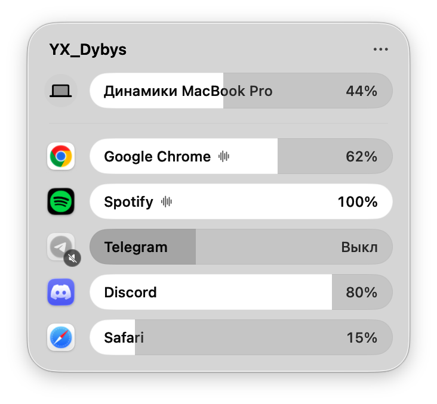

<div align="center">


# YX_Dybys

**Громкость каждого приложения прямо из строки меню macOS**

[](https://github.com/Bexull/YX_Dybys/releases/latest)


[](LICENSE)

<picture>
  <source media="(prefers-color-scheme: dark)" srcset="docs/images/panel-dark.png">
  
</picture>

*Дыбыс* по-казахски «звук». Часть набора [YX_Tools](https://github.com/Bexull/YX_Tools).

</div>

## Что умеет

- Своя громкость и «без звука» у каждого приложения, которое сейчас играет.
- Громкость устройства вывода первой строкой: динамики, наушники, AirPods, колонки.
- Стеклянная панель Liquid Glass выпадает из строки меню, как Пункт управления.
- Громкость запоминается для каждого приложения.
- Работает и со звонками: например, звук Microsoft Teams можно приглушить.
- Приложения на 100% не трогаются вообще: звук перехватывается только у тех, кому громкость убавили.

Всё работает на самом Маке: звук никуда не записывается и не отправляется.

## Установка

Нужны **macOS 26 Tahoe** и Mac на **Apple silicon** (M1 и новее).

1. Скачайте `YX_Dybys-1.0.zip` со страницы [последнего выпуска](https://github.com/Bexull/YX_Dybys/releases/latest)
   и откройте архив.
2. Перетащите YX_Dybys в папку «Программы».
3. Разрешите первый запуск. Приложение не нотаризовано Apple, поэтому macOS его остановит.
   Откройте YX_Dybys, нажмите «Готово», затем «Системные настройки» → «Конфиденциальность
   и безопасность» → внизу «Всё равно открыть». Или одной командой в Терминале:

   ```bash
   xattr -dr com.apple.quarantine /Applications/YX_Dybys.app
   ```

4. В строке меню появится значок с ползунками. Когда вы первый раз убавите громкость
   приложения, macOS попросит разрешение на запись системного звука. Оно нужно, чтобы менять
   громкость чужого звука; сам звук никуда не записывается.

Чтобы YX_Dybys запускался сам: правый клик по значку → «Открывать при входе в систему».

> [!TIP]
> Нужна ещё казахская клавиатура? [YX_Tools](https://github.com/Bexull/YX_Tools) — это YX_Dybys
> и [YX_KazQwerty](https://github.com/Bexull/YX_KazQwerty) в одном значке. Вместе с YX_Tools
> YX_Dybys не запускайте: в нём уже есть этот микшер.

## Как пользоваться

- **Клик по значку** открывает панель. Тяните полоску, чтобы изменить громкость; клик по иконке
  приложения выключает и включает его звук.
- **Правый клик по значку** или «⋯» в панели: автозапуск, «Вернуть всем 100%», выход.

## Частые вопросы

<details>
<summary>macOS пишет, что приложение повреждено или его нельзя открыть</summary>

Так Gatekeeper встречает приложения, не нотаризованные Apple. Выполните в Терминале
`xattr -dr com.apple.quarantine /Applications/YX_Dybys.app` или разрешите запуск в
«Конфиденциальность и безопасность».
</details>

<details>
<summary>Приложения нет в панели</summary>

В панели только приложения, которые сейчас воспроизводят звук. Включите в нём звук,
и оно появится.
</details>

<details>
<summary>Убавил громкость, и звук пропал совсем</summary>

Значит, нет разрешения на запись системного звука: без него macOS вместо звука приложения
отдаёт тишину. Включите YX_Dybys в «Системные настройки» → «Конфиденциальность и безопасность»
→ «Запись экрана и системного звука». Панель сама подсказывает это и открывает нужный раздел.
</details>

<details>
<summary>Как удалить</summary>

Выйдите из YX_Dybys (правый клик по значку → «Выйти») и удалите его из «Программ».
Сохранённые громкости удаляются так:

```bash
defaults delete com.bexul.dybys
```
</details>

## Сборка из исходников

Нужны macOS 26 и Xcode 26.

```bash
git clone https://github.com/Bexull/YX_Dybys.git
cd YX_Dybys
./build.sh --install
```

- `./build.sh` только собирает `build/YX_Dybys.app`, `--install` ставит в «Программы»,
  `--release` ещё и пакует `build/YX_Dybys-<версия>.zip`.
- Без сертификата сборка подписывается ad hoc, и после каждой пересборки macOS заново
  спрашивает разрешение. Чтобы не спрашивала, положите хэш своего сертификата Apple Development
  (из `security find-identity -v -p codesigning`) в файл `.sign-identity` или в переменную
  `MIXER_SIGN_IDENTITY`.

## Как устроено

- `Sources/Mixer/AppTap.swift`: перехват звука одного приложения (Core Audio process tap) →
  приватное aggregate-устройство → IOProc с громкостью → устройство вывода.
- `Sources/Mixer/MixerModel.swift`: какие приложения сейчас со звуком, сохранённые громкости,
  устройство вывода, общая громкость.
- `Sources/Mixer/MixerView.swift`, `Sources/Mixer/PanelController.swift`: интерфейс и стеклянная
  панель под значком в строке меню. Через `PanelAdditions` другое приложение может добавить в
  панель свои пункты; так YX_Tools встраивает казахскую клавиатуру.
- `Sources/App/DybysApp.swift`: значок в строке меню и его меню.
- `Resources/AppIcon.icon`: иконка Liquid Glass (открывается в Icon Composer).

**Отладка.**

- `YX_Dybys --snapshot <папка>` рисует панель в PNG, светлую и тёмную.
- `YX_Dybys --capture <папка> [light|dark]` открывает настоящую панель и снимает её окно с тенью.
- `pkill -USR1 -f YX_Dybys.app/Contents/MacOS/YX_Dybys` записывает состояние движка в
  `~/Library/Logs/YX_Dybys/state.txt`.

Нашли ошибку? [Расскажите](https://github.com/Bexull/YX_Dybys/issues/new?template=bug.yml).

## Лицензия

[MIT](LICENSE).

---

### In English

**YX_Dybys** (*dybys* is Kazakh for "sound") is a menu bar app for macOS 26 on Apple silicon. It
sets the volume of each app separately in a Liquid Glass panel, using Core Audio process taps;
apps left at 100% are never touched. Download the latest build from
[Releases](https://github.com/Bexull/YX_Dybys/releases/latest). The app is not notarized, so run
`xattr -dr com.apple.quarantine /Applications/YX_Dybys.app` after installing. It is part of
[YX_Tools](https://github.com/Bexull/YX_Tools), which also bundles it with a Kazakh keyboard.
MIT licensed.
